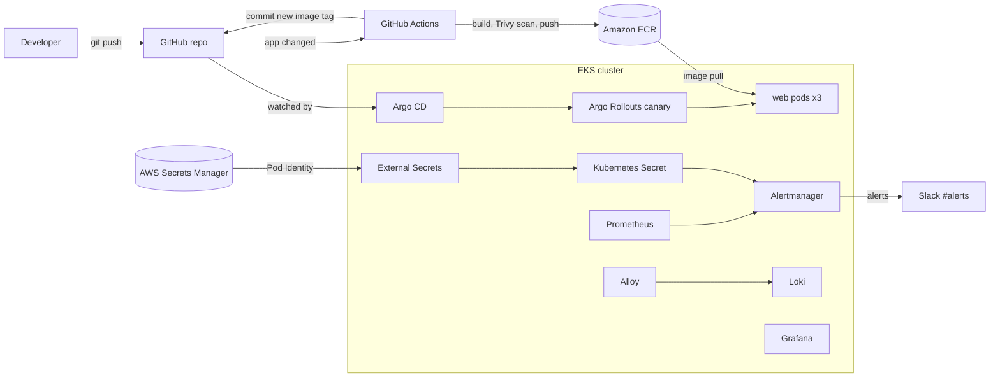
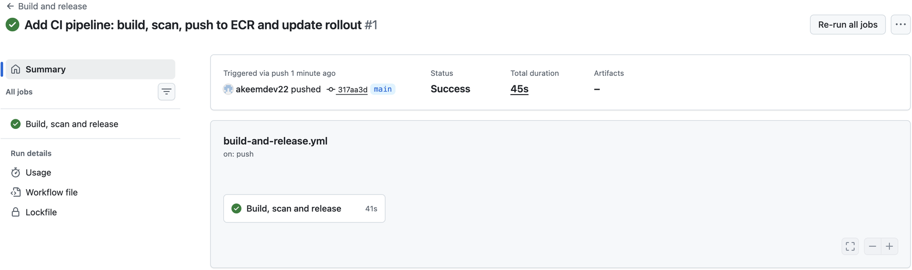
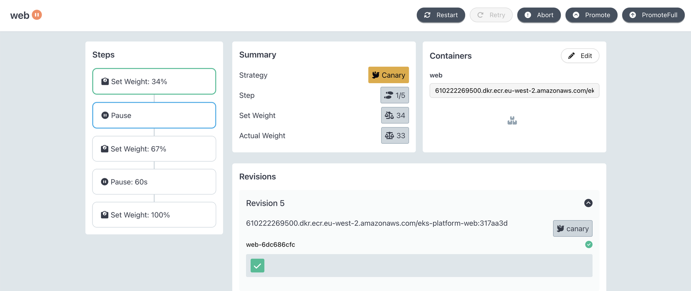
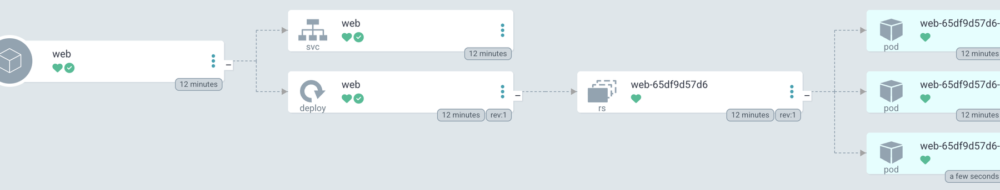
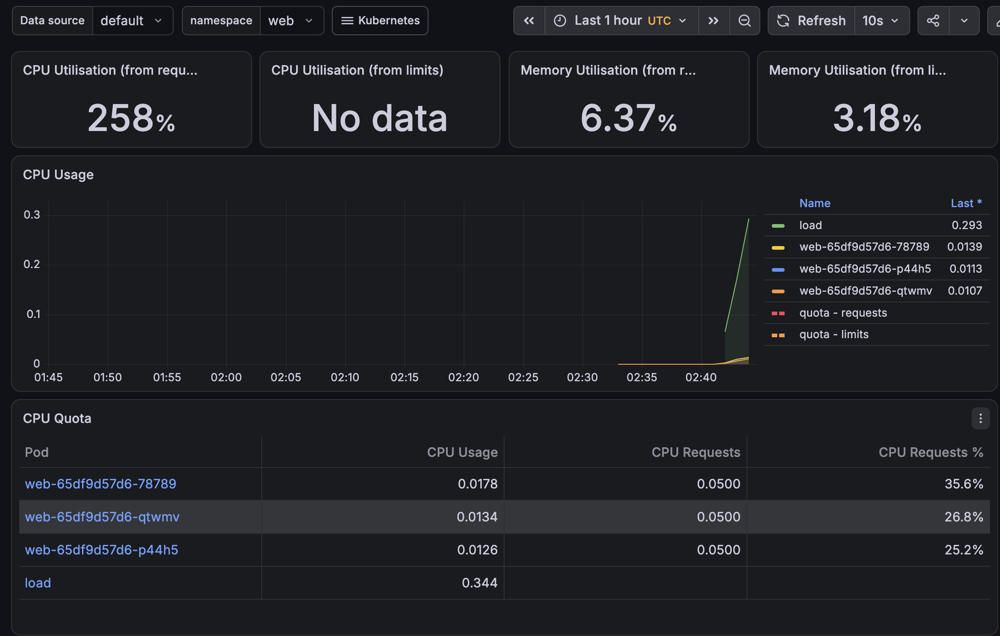
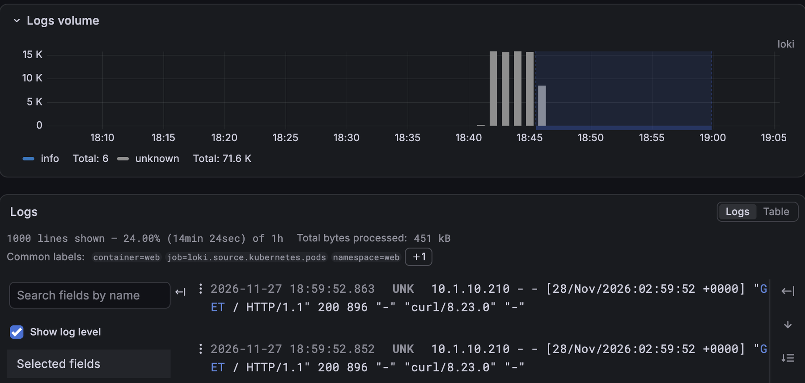
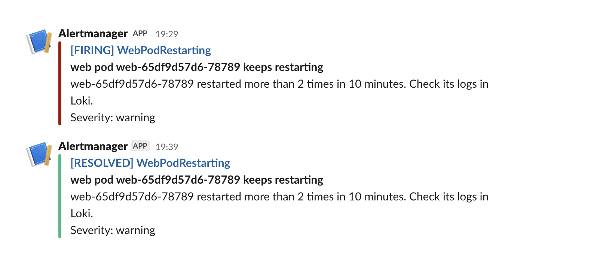

# EKS Platform with GitOps, Canary Releases and Monitoring

A small but complete Kubernetes platform on AWS, built the way a platform team would run it. Everything is defined in code, every change goes through Git, and new versions are released as canaries with monitoring and alerting watching them.

I built this to practise the full path from a code change to a safe production release on Amazon EKS.

## What it does

- **Terraform** builds the network, the EKS cluster, IAM roles, ECR and Secrets Manager
- **GitHub Actions** builds the app, scans it with Trivy and pushes it to ECR, logging in to AWS with OIDC (no stored keys)
- **Argo CD** deploys whatever is in Git, and puts the cluster back if someone changes it by hand
- **Argo Rollouts** releases new versions as a canary: one pod first, then a pause for approval, then the rest
- **Prometheus, Grafana and Loki** collect metrics and logs, with alert rules stored in Git
- **Alertmanager** sends alerts to Slack
- **External Secrets Operator** pulls secrets from AWS Secrets Manager using EKS Pod Identity

## Architecture



## How a release works

1. I change the website in `app/` and push to `main`.
2. GitHub Actions logs in to AWS with OIDC, builds the image, scans it with Trivy and stops if it finds a critical vulnerability.
3. The image is pushed to ECR, tagged with the commit ID, so I can always trace what is running back to the code.
4. The pipeline updates the image tag in `k8s/web/rollout.yaml` and commits it.
5. Argo CD sees the commit and syncs it to the cluster.
6. Argo Rollouts moves one of three pods to the new version and pauses.
7. I check Grafana and Loki, then promote it. The rollout goes to two pods, waits 60 seconds, then finishes.

If something looks wrong at the pause, I click **Abort** and all traffic goes back to the stable version within seconds. Then I run `git revert` so Git matches the cluster again.

The pipeline never talks to the cluster. It only builds the image and updates Git. Argo CD is the only thing that deploys.

**The pipeline run.** Build, Trivy scan and push to ECR in 45 seconds:



**The canary paused at 34%.** One pod runs the new image from ECR while the other two stay on the stable version:



**Argo CD keeping the cluster in line with Git:**



**The site running on EKS after the release:**


## Repository layout

```
app/                      Website and Dockerfile (non-root Nginx)
argocd/web-app.yaml       Argo CD Application that watches k8s/web
k8s/web/
  rollout.yaml            Argo Rollouts canary for the web app
  service.yaml            ClusterIP service
  alerts.yaml             Prometheus alert rules
  alertmanager-config.yaml  Routes web alerts to Slack
  secret-store.yaml       Connects External Secrets to AWS Secrets Manager
  slack-webhook-secret.yaml  Pulls the Slack webhook from AWS
monitoring/
  loki-values.yaml        Loki in single binary mode
  alloy-values.yaml       Alloy log collection from all pods
terraform/
  bootstrap/              GitHub OIDC role (kept between rebuilds)
  vpc.tf                  VPC, public and private subnets, NAT gateway
  eks.tf                  EKS 1.35 with a SPOT node group
  ecr.tf                  Private image repository with lifecycle policy
  secrets.tf              Secrets Manager entry, IAM role and Pod Identity link
docs/runbook.md           What to do when each alert fires
.github/workflows/        Build, scan and release pipeline
```

## Infrastructure

- **VPC** across 2 Availability Zones, with public subnets for load balancers and private subnets for the nodes
- **EKS 1.35** with managed add-ons: CoreDNS, kube-proxy, VPC CNI and the Pod Identity agent
- **Node group** of 2 to 3 `t3.large` SPOT instances to keep costs down
- **Terraform state** in S3 with native state locking

## Monitoring and alerting

Prometheus, Grafana and Alertmanager come from the `kube-prometheus-stack` Helm chart. Loki stores logs and Alloy ships them from every pod.

**Grafana during a load test.** CPU on the three web pods went from about 1% to over 25% of their requests, spread evenly across the pods:



**Searching the web app logs in Loki**, with Kubernetes probe noise filtered out using `{namespace="web"} != "kube-probe"`:



Alert rules live in Git and are deployed by Argo CD like everything else:

| Alert | Fires when | Severity |
|---|---|---|
| WebPodsUnavailable | Fewer than 3 web pods are ready for 2 minutes | warning |
| WebDown | No web pods are ready for 1 minute | critical |
| WebPodRestarting | A pod restarts more than twice in 10 minutes | warning |
| WebRolloutStuck | A pod is stuck on a bad image or crash loop for 5 minutes | warning |

Alerts post to a Slack channel, with a second message when the problem clears.



## Secrets

The Slack webhook is stored in AWS Secrets Manager, not in Git and not typed into the cluster. External Secrets Operator reads it and creates the Kubernetes Secret that Alertmanager uses.

External Secrets logs in to AWS through EKS Pod Identity, so there are no access keys anywhere. Its IAM role can read that one secret and nothing else.

## Game days

I broke things on purpose to check that the platform behaves the way I expect.

| Test | What happened | What I changed |
|---|---|---|
| Crashed a web pod 3 times | WebPodRestarting fired in Slack in about a minute and resolved 10 minutes later. The other 2 pods kept serving traffic. | Nothing needed |
| Deployed an image tag that does not exist | The new pod got stuck on ImagePullBackOff while the old pods kept serving users. No alert fired. | Added the WebRolloutStuck alert to close the gap |
| Scaled the deployment by hand to 1 pod | Argo CD noticed the drift and put it back to 3 within seconds | Nothing needed |
| Released a "bad" version as a canary and aborted it | Traffic went back to the stable version in seconds. Only 1 in 3 pods ever ran the new version. | Finished the abort with `git revert` so Git and the cluster matched |

Steps for each alert are in [docs/runbook.md](docs/runbook.md).

## Problems I ran into

**Loki kept crashing.** The logs showed `mkdir /var/loki: read-only file system`. The container's file system is read-only, and with persistence turned off there was no volume mounted for its data. I added an `emptyDir` volume at `/var/loki`.

**My alerts would have gone silent.** The first alert rules used Deployment metrics. When I switched to an Argo Rollout, those metrics would have disappeared and the alerts would never fire again, with nothing to show they were broken. I rewrote them to use pod-level metrics, which work whatever creates the pods. I also used `or vector(0)` in the WebDown rule, because a `sum()` over zero pods returns nothing rather than 0.

**Argo CD kept showing OutOfSync on the ExternalSecret.** External Secrets fills in default values for some fields, so the live object never matched Git. Writing those defaults out in the YAML fixed it.

**Port-forward showed the old version.** `kubectl port-forward svc/...` picks one pod and sticks to it, so during a canary it can land on an old pod. Restarting the port-forward after the rollout finished showed the new site.

## Running it yourself

You need an AWS account, Terraform, kubectl, Helm and the AWS CLI.

```bash
# 1. One-off: create the GitHub OIDC role
cd terraform/bootstrap && terraform init && terraform apply

# 2. Build the cluster (about 20 minutes)
cd .. && terraform init && terraform apply
aws eks update-kubeconfig --region eu-west-2 --name eks-platform

# 3. Install the platform tools
helm repo add argo https://argoproj.github.io/argo-helm
helm repo add prometheus-community https://prometheus-community.github.io/helm-charts
helm repo add grafana https://grafana.github.io/helm-charts
helm repo add external-secrets https://charts.external-secrets.io
helm repo update

helm install argocd argo/argo-cd -n argocd --create-namespace
helm install argo-rollouts argo/argo-rollouts -n argo-rollouts --create-namespace --set dashboard.enabled=true
helm install monitoring prometheus-community/kube-prometheus-stack -n monitoring --create-namespace
helm install loki grafana/loki -n monitoring -f monitoring/loki-values.yaml
helm install alloy grafana/alloy -n monitoring -f monitoring/alloy-values.yaml
helm install external-secrets external-secrets/external-secrets -n external-secrets --create-namespace

# 4. Add the Slack webhook to Secrets Manager
aws secretsmanager put-secret-value --secret-id eks-platform/slack-webhook --secret-string "<webhook-url>" --region eu-west-2

# 5. Hand the app over to Argo CD
kubectl apply -f argocd/web-app.yaml
```

To tear it all down:

```bash
cd terraform && terraform destroy
```

## Cost

Running the cluster costs roughly $5 to $8 a day, mostly the EKS control plane, the NAT gateway and two SPOT nodes. I build it when I am working on it and destroy it at the end of each session, so a 3 to 4 hour session costs about $1.

## What I would add next

- Automated canary analysis, so Argo Rollouts checks error rates in Prometheus and aborts on its own
- Install the platform tools through Argo CD as well (app of apps) instead of Helm commands
- Move the Secrets Manager entry into the bootstrap stack so it survives a rebuild
- Update the GitHub Actions to versions that run on Node.js 24
